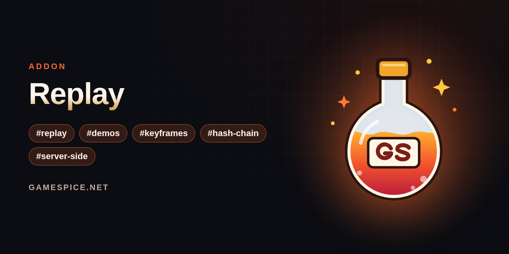

[](https://moddingcommunity.com/a/261-dot-replay)

Records what a dedicated server decided during a match (snapshots, events, chat, commands) so the match can be played back later: to watch it, to review it, or as evidence when somebody is reported.

A record is a tick, a channel name and a payload: raw bytes, or any plain value such as a Dictionary, an Array, numbers, strings or vectors. The addon never looks inside a payload, so the same format works for a shooter, a racing timer or a lobby.

| Feature | How it works |
| --- | --- |
| Seeking | Every few seconds the recorder asks the game for a keyframe (a full copy of its state). Playback jumps to any tick by starting from the nearest keyframe and playing forward. |
| Crash safe | Chunks (one second by default) are saved as soon as they are complete. A crashed server leaves a file that plays up to its last whole chunk. |
| Tamper evident | Each chunk has a hash that also covers the chunk before it, so changing, removing or reordering any part is caught. Give the recorder a key and the hashes become HMACs only the key holder can make. |
| Small files | Chunks are compressed (zstd by default). A file that reaches its size limit is finished cleanly. |
| "Save that" | The most recent play is kept in memory and any part of it can be written out as a normal replay. |

## Install

1. Get [Godot 4.7](https://godotengine.org/download).
2. Either use [dot-bootstrap](https://github.com/gamespice-platform/bootstrap), which clones every project and links the addons, or copy `addons/dot_replay/` and [dot-core](https://github.com/gamespice-platform/core)'s `addons/dot_core/` into your project and enable dot-replay in *Project > Project Settings > Plugins*.

dot-core is the only dependency.

## Recording

```gdscript
var config := DotReplayConfig.new()
config.load_layered()                                    # lets the settings below change without a rebuild

var rec := DotReplayRecorder.new()
rec.configure(config, 64)                                # 64 ticks per second
rec.keyframe_fn = func(_tick: int) -> Variant: return game.capture_state()
var header := DotReplayHeader.make("fc", "dm_box", 64, players)
rec.start(header, "user://replays/match.dreplay")

# every server tick, before anything of that tick is recorded:
rec.advance(tick)
rec.record_value(tick, &"events", {"kill": [attacker, victim]})
rec.record(tick, &"snapshot", snapshot_bytes)

var evidence: Dictionary = rec.stop().value              # path, final hash, tick range, size
```

To save the last thirty seconds while still recording:

```gdscript
rec.save_clip("user://replays/clip.dreplay", 30.0)
```

A clip starts at the keyframe before the time you asked for, so it can be a little longer. It plays, seeks and verifies like any other replay.

## Playing back

`DotReplayPlayer` emits records and your game applies them:

```gdscript
var player := DotReplayPlayer.new()
add_child(player)
player.state_reset.connect(func(tick, state): game.restore_state(state))   # after a seek
player.record_played.connect(func(record): game.apply(record.channel, record.value()))
player.finished.connect(func(): show_end_screen())

player.open("user://replays/match.dreplay")             # refused if any chunk was changed
player.play()

# every frame:
player.poll()
```

| Call | Does |
| --- | --- |
| `set_speed(2.0)` | Playback speed. Default 1.0; any positive value (no upper or lower limit). Zero or a negative value is refused with an error and returns `false`. |
| `pause()`, `resume()` | Pause and resume. |
| `seek(tick)` | Jump to any tick. |
| `set_channels(["chat", "events"])` | Play only these channels. |
| `step_ticks(1)` | Move forward exactly one tick. |

## Connecting a server

Two small bridges record from other addons without depending on them:

- `DotReplayEventTap` records every event a server's event bus fires, including ones a hook cancelled. Use `attach(bus)` and `detach()`.
- `DotReplayNetTap` records the snapshot stream a netcode manager sends to one peer.

## Settings

`DotReplayConfig` is layered like every GameSpice config: inspector defaults, then a JSON file, then the environment, then the command line. Times are in seconds.

```bash
GS_REPLAY_COMPRESSION=deflate <your server> --replay-ring-seconds=300
```

| Setting | Default | What it does |
| --- | --- | --- |
| `directory` | `user://replays` | Where finished replays are written. |
| `chunk_seconds` | 1.0 | How much one chunk holds, and so the most a crash can lose. |
| `chunk_kib` | 256 | A chunk is closed early at this size. |
| `keyframe_seconds` | 10 | How often to ask the game for a keyframe. 0 turns it off. |
| `compression` | `zstd` | `zstd`, `deflate`, `gzip`, `fastlz` or `none`. |
| `max_file_mib` | 512 | A replay is finished cleanly at this size. 0 = unlimited. |
| `max_record_kib` | 1024 | A single record larger than this is refused. |
| `ring_seconds` | 60 | How much recent play is kept in memory for clips. 0 turns it off. |
| `ring_max_mib` | 32 | Memory the clip buffer may use. |

## Testing

Import the project once, then run `examples/replay_selftest.tscn` headless with Godot.

## Status and licence

Part of the [**GameSpice**](https://gamespice.net) platform: a family of Godot addons. Written with Claude Code and maintained by `gamemann`. Every addon has headless tests, but little of this has been played by real users yet, so expect rough edges and please [open an issue](https://github.com/gamespice-platform/replay/issues) when you hit one.

MIT licence, see [LICENSE](LICENSE). The only closed part of the [**GameSpice**](https://gamespice.net) platform is the web back end; you can use your own instead of GameSpice's.
